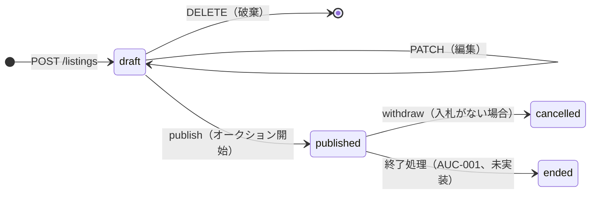

# 出品 API（LST-004）

- 状態: 実装済み（`apps/api/app/listings/`）
- 関連: [ADR-0004](../adr/0004-auction-operating-rules.md)（編集・取り下げ）、[ADR-0007](../adr/0007-align-with-yahoo-auctions.md)（自動延長・即決）、[ADR-0008](../adr/0008-mvp-implementation-provisional-decisions.md)（入力項目の仮の値）、[テーブル設計](../architecture/database-schema.md)、[トランザクション設計](../architecture/auction-bid-transaction.md)
- 試し方: `docker compose up` → http://localhost:8000/docs（開発用ログインで `seller1` などとしてログインしてから）

## 共通

- JSON のキーは **camelCase**、金額は `...Yen`（整数の円）、日時は UTC の RFC 3339（例: `2026-11-16T14:20:56Z`）。API 仕様書（`openapi.md`）の共通契約に合わせる。
- エラーは `{"error": {"code": "...", "message": "...", "details": {...}}}`。入力エラーは `VALIDATION_ERROR` で、`details.fields` に項目ごとの理由が入る。
- 他人の下書き・取り下げた出品・存在しない出品は、区別せず **404** を返す（存在を知られないため）。

## API 一覧

| メソッド・パス | 内容 | ログイン |
|---|---|---|
| `GET /api/v1/categories` | カテゴリ一覧 | 不要 |
| `GET /api/v1/listings` | 公開中・開催中の出品を検索 | 不要 |
| `GET /api/v1/listings/{id}` | 出品の詳細（下書きなどは本人のみ） | 不要（本人確認に使う） |
| `GET /api/v1/me/listings` | 自分の出品（下書き・取り下げを含む） | 必要 |
| `POST /api/v1/listings` | 下書きを作る | 必要 |
| `PATCH /api/v1/listings/{id}` | 下書きを編集する | 必要（本人） |
| `DELETE /api/v1/listings/{id}` | 下書きを破棄する | 必要（本人） |
| `POST /api/v1/listings/{id}/publish` | 公開してオークションを開始する | 必要（本人） |
| `POST /api/v1/listings/{id}/withdraw` | 公開中の出品を取り下げる（入札がない場合） | 必要（本人） |

## 出品の状態



## 下書きを作る `POST /api/v1/listings`

```json
{
  "title": "木の持ち手の小さなかご",
  "description": "数回使用しました。",
  "categoryId": 2,
  "condition": "like_new",
  "shippingPayer": "seller",
  "shippingMethod": "ゆうパケット",
  "startPriceYen": 1000,
  "buyoutPriceYen": 5000,
  "autoExtension": true,
  "durationHours": 72
}
```

| 項目 | 必須 | ルール（ADR-0008 の仮の値） |
|---|---|---|
| `title` | ○ | 1〜60文字（前後の空白は除く） |
| `description` | ○ | 1〜500文字、プレーンテキスト |
| `categoryId` | ○ | `GET /categories` の ID |
| `condition` | ○ | `new`（新品・未使用）/ `like_new`（目立った傷や汚れなし）/ `some_wear`（やや傷や汚れあり）/ `worn`（傷や汚れあり） |
| `shippingPayer` | ○ | `seller`（出品者負担）/ `buyer`（落札者負担） |
| `shippingMethod` | ○ | 1〜80文字 |
| `startPriceYen` | ○ | 1〜10,000,000 |
| `buyoutPriceYen` | | 開始価格より高く、10,000,000 以下 |
| `autoExtension` | | 既定 `true`（ADR-0007） |
| `durationHours` | ○ | 13〜179（13時間〜7日11時間、ADR-0007）。公開時刻からの時間 |

- 返り値は出品の詳細（下の「出品の詳細」）。状態は `draft`、`version` は 1。
- 表示名（ニックネーム）が未設定の会員は出品できない（403 `NICKNAME_REQUIRED`）。

## 下書きを編集する `PATCH /api/v1/listings/{id}`

```json
{ "expectedVersion": 1, "title": "大きなかご", "buyoutPriceYen": null }
```

- 送った項目だけを変える。`buyoutPriceYen: null` で即決価格を外せる。
- **`expectedVersion`（必須）** は、画面に表示したときの `version`。保存のたびに `version` が1増える。別のタブなどで先に保存されていたら **409 `VERSION_CONFLICT`**（`details.currentVersion` に最新の値）を返し、上書きしない（楽観ロック）。
- 公開後の編集は、まだできない（409 `LISTING_NOT_EDITABLE`）。ADR-0004 の「入札がなければ編集できる」は、入札（BID-001）の実装後に対応する。

## 公開する `POST /api/v1/listings/{id}/publish`

```json
{ "expectedVersion": 2 }
```

- 下書きを公開し、**同時にオークションを開始する**（ADR-0008）。終了日時は「公開時刻＋`durationHours`」。
- 出品条件（開始価格・即決価格・自動延長）はオークション（`auction`）に写し、公開後はそちらが正になる。
- 下書き以外は 409 `LISTING_NOT_EDITABLE`、`version` が古ければ 409 `VERSION_CONFLICT`。

## 取り下げる `POST /api/v1/listings/{id}/withdraw`

```json
{ "expectedVersion": 2 }
```

- 公開中で、入札がない出品だけ取り下げられる（ADR-0004）。出品とオークションの状態は `cancelled` になり、ほかの人からは見えなくなる。
- 入札との競合を防ぐため、**オークションの悲観ロック**（`app/locking.py`）を取ってから状態を確認する。
- 入札がある場合は 409 `HAS_BIDS`。入札があっても、[早期終了](auctions.md) はできる。

## 検索 `GET /api/v1/listings`

| パラメーター | 内容 |
|---|---|
| `q` | キーワード（タイトル・説明の部分一致、最大100文字）。`%` や `_` も文字として扱う |
| `categoryId` | カテゴリで絞り込み |
| `sort` | `ending`（終了が近い順、既定）/ `newest`（新着順）/ `price_asc`・`price_desc`（現在の価格の安い順・高い順）/ `bids`（入札数の多い順） |
| `limit` / `offset` | 1ページの件数（1〜50、既定20）と開始位置 |

```json
{
  "items": [
    {
      "id": 1, "status": "published", "title": "白釉の花器",
      "category": {"id": 2, "name": "インテリア"},
      "condition": "like_new", "conditionLabel": "目立った傷や汚れなし",
      "seller": {"id": 1, "displayName": "seller1"},
      "currentPriceYen": 2400, "buyoutPriceYen": 6000, "bidCount": 0,
      "endsAt": "2026-11-16T14:20:56Z", "publishedAt": "2026-11-13T14:20:56Z"
    }
  ],
  "limit": 20, "offset": 0, "hasMore": false
}
```

- 公開中（`published`）で、オークションが開催中かつ終了時刻前のものだけ。
- 検索は当面 `LIKE`（ADR-0006）。価格・入札数の並び替えは、オークションの集計列（`current_price`・`bid_count`、BID-001）を使う。
- ページ送りは当面 `limit` / `offset`。API 仕様書の「カーソル方式等」は、件数が増えたら見直す。

## 出品の詳細（各 API の返り値）

```json
{
  "id": 1, "status": "published", "version": 2,
  "title": "白釉の花器", "description": "手仕事の花器です",
  "category": {"id": 2, "name": "インテリア"},
  "condition": "like_new", "conditionLabel": "目立った傷や汚れなし",
  "shippingPayer": "seller", "shippingMethod": "ゆうパケット",
  "startPriceYen": 2400, "buyoutPriceYen": 6000, "autoExtension": true, "durationHours": 72,
  "seller": {"id": 1, "displayName": "seller1"},
  "createdAt": "...", "updatedAt": "...", "publishedAt": "...",
  "auction": {
    "status": "active", "startsAt": "...", "endsAt": "...",
    "startPriceYen": 2400, "buyoutPriceYen": 6000, "autoExtension": true,
    "currentPriceYen": 2400, "minimumBidYen": 2400, "bidCount": 0,
    "endReason": null, "endedAt": null
  }
}
```

- `auction` は公開前は `null`。
- `currentPriceYen`・`minimumBidYen`・`bidCount` は、自動入札と入札単位（ADR-0007）で計算した値（[入札 API](bids.md)）。入札がなければ「開始価格・開始価格・0」。最高額入札者・最高入札額は返さない。

## エラーコード

| HTTP | `code` | 意味 |
|---|---|---|
| 401 | `UNAUTHENTICATED` | ログインしていない（API 仕様書のコード名に合わせた） |
| 403 | `NICKNAME_REQUIRED` | 表示名（ニックネーム）が未設定 |
| 404 | `LISTING_NOT_FOUND` | 出品がない、または見る権限がない（存在しない URL は `NOT_FOUND`） |
| 409 | `VERSION_CONFLICT` | `expectedVersion` が古い（ほかで更新された） |
| 409 | `LISTING_NOT_EDITABLE` | その状態ではできない操作（公開済みの編集・二重公開など） |
| 409 | `HAS_BIDS` | 入札がある出品は取り下げできない |
| 422 | `VALIDATION_ERROR` | 入力の誤り（`details.fields`） |
