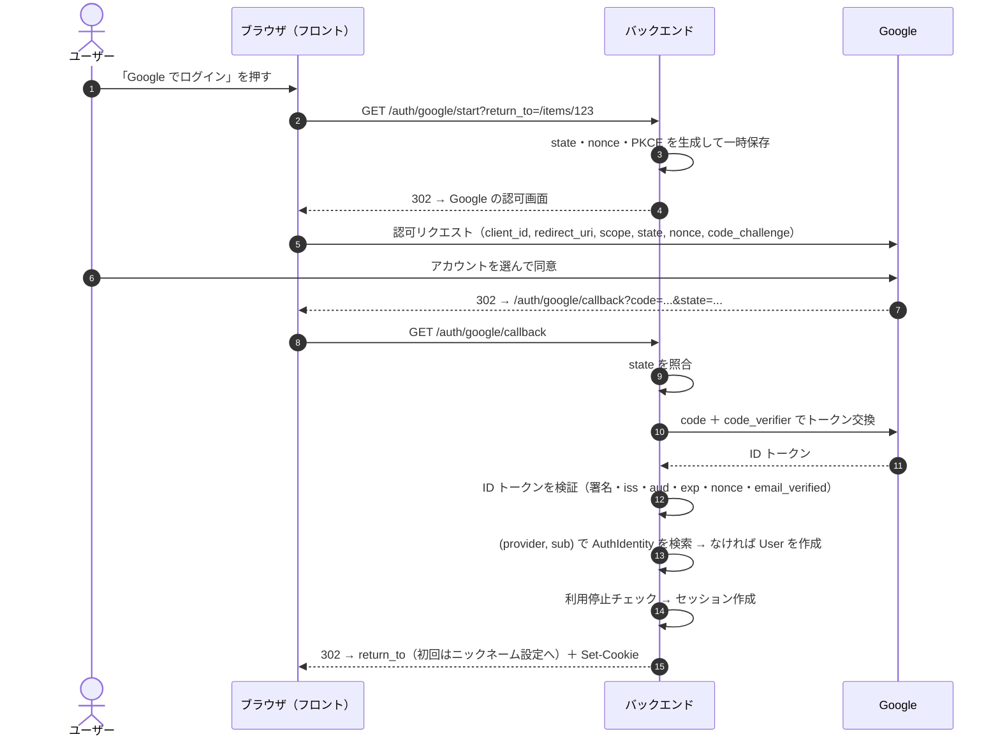

# AUTH-001: Google ログイン（設計）

- 機能ID: AUTH-001
- 状態: 提案中（チーム確認待ち）
- 要件: [`../product/auth-001-google-login.md`](../product/auth-001-google-login.md)
- 作成日: 2026-10-30
- 前提: バックエンドは FastAPI（[ADR-0001](adr/0001-backend-framework.md)。Hono はサブ候補）。設計自体はフレームワークに依存しない形で書いている。
- Google 側の仕様は、末尾の「付録：Google 側の仕様（2026-10-30 確認）」を参照。

## 方式

**OpenID Connect の Authorization Code Flow をサーバー側で処理する**（`state`・`nonce`・PKCE つき）。

- ブラウザだけで完結する方式（ID トークンをフロントで受け取って使う方式）は採らない。サーバーでトークンを検証し、サーバー側のセッションを発行する。
- 要求するスコープは `openid email profile` のみ。

## API

| メソッド・パス | 役割 | 備考 |
|---|---|---|
| `GET /auth/google/start` | Google の認可画面へリダイレクト | `return_to` はサイト内のパスだけ許可（オープンリダイレクト対策） |
| `GET /auth/google/callback` | Google から戻ってきたときの処理 | `state` 照合、トークン交換・検証、ユーザー作成・ログイン |
| `POST /auth/logout` | ログアウト | CSRF 対策が必要 |
| `GET /me` | ログイン中のユーザー情報 | 未ログインなら 401 |
| `PATCH /me` | ニックネーム設定 | 初回設定と、その後の変更 |

## データモデル

AGENTS.md 4章の `User` / `AuthIdentity` を具体化し、`Session` を追加する。

**`User`**
- `id`
- `display_name`（ニックネーム。初回は未設定）
- `status`（`active` / `suspended`）
- `role`（`member` / `admin`）
- `created_at`、`updated_at`

**`AuthIdentity`**
- `id`、`user_id`
- `provider`（`'google'`）
- `provider_subject`（Google の `sub`）
- `email`、`email_verified`（ログインのたびに最新の値で更新）
- `created_at`、`last_login_at`
- 制約：**`(provider, provider_subject)` にユニーク制約**（同時に初回ログインしても、ユーザーが重複して作られない）

**`Session`**
- `id`
- `token_hash`（セッション ID の**ハッシュ値**を保存し、生の値は保存しない）
- `user_id`、`expires_at`、`revoked_at`、`created_at`
- `user_agent` などは必要最小限（個人情報の扱いに注意）

## セッション・Cookie

- セッション ID：暗号論的乱数で256ビット以上
- Cookie の属性：`HttpOnly`・`Secure`・`SameSite=Lax`・`Path=/`。`__Host-` 接頭辞を使う
  - `SameSite=Lax` にするのは、Google からのリダイレクト（トップレベルの GET）でも Cookie を送るため
- ログインのたびに新しいセッション ID を発行する（セッション固定攻撃の対策）
- ログアウトや利用停止のときは、サーバー側の `Session` を無効化する
- 有効期限：未決（要件の未決事項を参照）

## 検証・セキュリティ

**ID トークンの検証**
- 署名・`aud`（自分のクライアント ID）・`exp` は、ライブラリで検証する
- `iss` は `https://accounts.google.com` または `accounts.google.com` であることを確認する
  - ライブラリによっては `iss` を確認しないものがある（例：Python の `verify_oauth2_token`）。その場合は自分でチェックする
- `nonce` が一時保存した値と一致することを確認する
- `email_verified` が `true` であることを確認する

**その他**
- ユーザーの識別には `sub` を使い、`email` は使わない。Google Workspace の組織を判定する場合は、メールのドメインではなく `hd` クレームを使う
- `state`・`nonce`・`code_verifier` は短い有効期限で一時保存し、1回使ったら破棄する
- エラー画面に、内部の詳細（例外メッセージやトークンの中身）を出さない
- 環境変数：`GOOGLE_CLIENT_ID`、`GOOGLE_CLIENT_SECRET`、`GOOGLE_REDIRECT_URI`。リダイレクト URI は環境ごと（local / staging / production）に Google Cloud Console へ登録する

## ライブラリ候補

| バックエンド | 候補 | 備考 |
|---|---|---|
| **FastAPI（採用）** | Authlib | 未検証。導入時に保守状況とライセンスを確認する（AGENTS.md 11章 7）。`google-auth` の `verify_oauth2_token` を使う場合は `iss` を自前で確認する |
| Hono（サブ候補） | `@hono/oauth-providers`、Auth.js（`@hono/auth-js`）、`arctic` | 未検証。Hono を採用する場合のみ検討 |

## 現在の静的プロトタイプへの影響

- `index.html` のログインダイアログは、デモ用の案内のままにする。
- バックエンドがないと ID トークンを安全に検証できないため、本物の Google ログインはバックエンドの導入後に実装する。
- 導入時は、コード側に `Feature AUTH-001: ...` コメントを付ける。

## テストケース

| # | 種類 | 内容 | 期待結果 |
|---|---|---|---|
| T-01 | 統合 | 新しい Google アカウントでコールバック | `User`・`AuthIdentity`・`Session` が作成され、ニックネーム設定へリダイレクトされる |
| T-02 | 統合 | 既存のアカウントで再ログイン | 新しい `User` は作られず、既存の `User` に新しいセッションが作られる |
| T-03 | 統合 | 同じ `sub` で同時に初回コールバックを2回 | `User` は1件だけ作られる（ユニーク制約） |
| T-04 | 統合 | `sub` は同じでメールアドレスだけ変わったアカウント | 同じユーザーとしてログインし、`email` が更新される |
| T-05 | セキュリティ | `state` が一致しない／ない | 拒否され、セッションは作られない |
| T-06 | セキュリティ | `aud` が別のクライアント ID の ID トークン | 拒否される |
| T-07 | セキュリティ | `iss` が不正、または期限切れ（`exp`）の ID トークン | 拒否される |
| T-08 | セキュリティ | `nonce` が一致しない | 拒否される |
| T-09 | セキュリティ | `email_verified = false` | 拒否され、理由が表示される |
| T-10 | セキュリティ | `return_to=https://evil.example` | サイト外へはリダイレクトせず、トップへ戻す |
| T-11 | 統合 | 利用停止ユーザーでログイン | セッションは作られず、理由が表示される |
| T-12 | 統合 | ログイン中に利用停止にする | 次のリクエストから未ログイン扱いになる |
| T-13 | 統合 | ログアウト後に、古いセッション Cookie を使う | 401 になる |
| T-14 | セキュリティ | 別サイトからの `POST /auth/logout`（CSRF） | 拒否される |
| T-15 | E2E | Google の画面でキャンセル（`error=access_denied`） | ログイン前の画面に戻り、案内メッセージが表示される |
| T-16 | セキュリティ | ログの確認 | ID トークン・認可コード・セッション ID がログに出ていない |
| T-17 | 統合 | ログインの開始を短時間に大量に実行 | レート制限で 429 になる |

## 付録：Google 側の仕様（2026-10-30 確認）

仕様やプランは変わることがあるので、実装時に再確認すること。

| 項目 | 内容 | 出典 |
|---|---|---|
| `iss` | `https://accounts.google.com` または `accounts.google.com` | [Verify the Google ID token](https://developers.google.com/identity/gsi/web/guides/verify-google-id-token) |
| `aud` | 自分のアプリのクライアント ID と一致すること | 同上 |
| `exp` | 有効期限が過ぎていないこと | 同上 |
| ライブラリの検証範囲 | Node.js の `verifyIdToken` は署名・`aud`・`iss`・`exp` を検証する。Python の `verify_oauth2_token` は署名・`aud`・`exp` だけで、`iss` は自分で確認する | 同上 |
| `sub` | Google アカウント間で一意で、再利用されない。主キーに使う | [OpenID Connect](https://developers.google.com/identity/openid-connect/openid-connect) |
| `email` | このアカウントに固有とは限らず、変わることもある。主キーには使わない | 同上 |
| `email` / `email_verified` | `email` スコープを要求したときだけ含まれる。tokeninfo エンドポイントでは `email_verified` が文字列 `"true"` / `"false"` で返る | 同上 / [Reference](https://developers.google.com/identity/openid-connect/reference) |
| Workspace の判定 | メールのドメインではなく `hd` クレームを使う | 同上 |
| 「テスト中」の制限 | テストユーザーは最大100人 | [Manage App Audience](https://support.google.com/cloud/answer/15549945?hl=en) |
| 上の制限の例外 | `userinfo.email` / `userinfo.profile` / `openid` だけを要求するアプリ（Sign in with Google）は、テストユーザーの登録不要・7日失効の対象外。ほかのスコープを要求すると例外にならない | 同上 |
| 更新トークン | 「テスト中」かつ外部ユーザーのアプリでは7日で失効する（基本のスコープだけなら対象外）。1アカウント・1クライアントあたり100個まで | [Using OAuth 2.0](https://developers.google.com/identity/protocols/oauth2) |
| 公開・審査 | 「本番環境」にするには、名前やロゴの表示のために審査が必要になる場合がある | [OAuth app state overview](https://developers.google.com/identity/protocols/oauth2/production-readiness/overview) |

