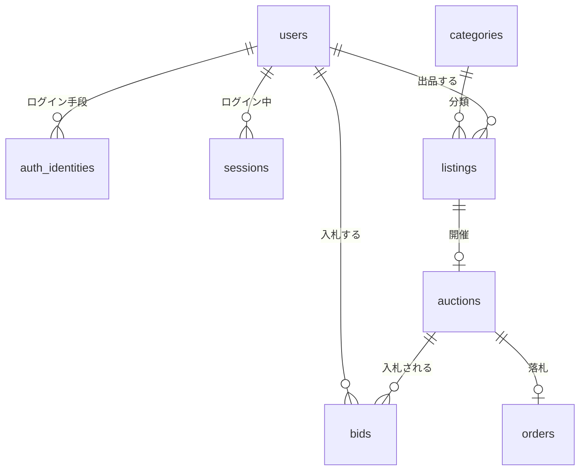

# データベースのテーブル設計

- 状態: 一部実装（「実装状況」の列を参照）
- 関連: [ドメインモデル](domain-model.md)、[入札・終了のトランザクション設計](auction-bid-transaction.md)、[ADR-0006](../adr/0006-database-sqlite-to-postgresql.md)（SQLite3 → PostgreSQL）、[ADR-0007](../adr/0007-align-with-yahoo-auctions.md)（入札・終了のルール）、[ADR-0008](../adr/0008-mvp-implementation-provisional-decisions.md)（仮の値）
- 実装: `apps/api/app/models/`、マイグレーションは `apps/api/alembic/versions/`

テーブルは機能ごとの PR で、マイグレーションを足しながら増やしていく。この文書は全体の設計図で、実装したら「実装状況」を更新する。

## 共通ルール

| 項目 | ルール | 理由 |
|---|---|---|
| 主キー | 整数の連番（`id`） | SQLite3 と PostgreSQL の両方で同じように動く |
| 日時 | すべて UTC。アプリ独自の型 `UTCDateTime` を使い、タイムゾーンのない日時は保存時にエラーにする | ADR-0006（SQLite3 には日時型がない） |
| 金額 | 整数の円（`Integer`）。`CHECK` で 1円〜1,000万円 | AGENTS.md、ADR-0008 |
| 選択肢（状態など） | 文字列＋`CHECK (列 IN (...))` | DB 固有の列挙型を使わず、両方の DB で同じ定義にする |
| 制約の名前 | `pk_`・`fk_`・`uq_`・`ck_`・`ix_` の命名規則で必ず名前を付ける | 名前がないと、SQLite3 の batch モードや移行時に Alembic が制約を特定できない |
| マイグレーション | Alembic。リビジョン ID は `0001`、`0002` … の連番。マイグレーションにアプリのコードを import しない | 順番が分かりやすく、アプリを変えても古いマイグレーションが壊れない |

## 全体図

## テーブル一覧

| テーブル | 内容 | 機能ID | 実装状況 |
|---|---|---|---|
| `users` | 会員 | AUTH-001 / AUTH-002 | ✅ 0001 |
| `auth_identities` | ログイン手段（Google の `sub`、開発用ログイン） | AUTH-001 / AUTH-002 | ✅ 0001 |
| `sessions` | ログインセッション | AUTH-001 / AUTH-002 | ✅ 0001 |
| `categories` | カテゴリ（初期データ5件） | LST-004 | ✅ 0001 |
| `listings` | 出品（商品情報と出品条件） | LST-004 | ✅ 0001・0002（API: [出品 API](../api/listings.md)） |
| `auctions` | オークションの開催情報 | LST-004 / BID-001 / AUC-001 | ✅ 0001（公開・取り下げは出品 API。入札・終了は今後） |
| `bids` | 入札（最高入札額） | BID-001 | ✅ 0003（API: [入札 API](../api/bids.md)） |
| `bid_requests` | 入札の冪等性キーと結果 | BID-001 | ✅ 0003 |
| `orders` | 落札後の取引 | BID-001（即決）/ AUC-001（終了・早期終了） | ✅ 0003（即決で作成。終了処理は今後） |
| `outbox_events` | 通知などの送信待ちイベント | AUC-001 / NTF | 予定 |
| `audit_logs` | 管理操作の監査記録 | MOD-002 | 予定 |

## 実装済みのテーブル（0001・0002）

### `users`

| 列 | 型 | 制約・説明 |
|---|---|---|
| `id` | 整数 | 主キー |
| `display_name` | 文字列(30) | 公開する表示名。初回は未設定（NULL）。Google の氏名は使わない（AUTH-001） |
| `status` | 文字列 | `active` / `suspended` / `withdrawn`。`active` 以外はログイン中でも未ログイン扱い |
| `role` | 文字列 | `member` / `admin`（管理者の作り方は MOD-001 で決める） |
| `created_at` / `updated_at` | 日時(UTC) | |

### `auth_identities`

| 列 | 型 | 制約・説明 |
|---|---|---|
| `id` | 整数 | 主キー |
| `user_id` | 整数 | `users.id` |
| `provider` | 文字列 | `google` / `dev`。**本番 DB に `dev` があってはならない**（ADR-0008） |
| `provider_subject` | 文字列(255) | Google の `sub`、または開発用ログインの表示名 |
| `email` / `email_verified` | 文字列 / 真偽値 | Google から受け取る値。識別には使わない |
| `created_at` / `last_login_at` | 日時(UTC) | |

- **`(provider, provider_subject)` は一意。** 同時に初回ログインしても会員が二重に作られない（AUTH-001 T-03）。

### `sessions`

| 列 | 型 | 制約・説明 |
|---|---|---|
| `id` | 整数 | 主キー |
| `user_id` | 整数 | `users.id` |
| `token_hash` | 文字列(64) | セッション ID の **SHA-256 ハッシュ値**（一意）。生の値は保存しない |
| `created_at` / `expires_at` / `revoked_at` | 日時(UTC) | 有効期間は `SESSION_TTL_HOURS`（仮に30日）。ログアウトで `revoked_at` を入れる |

### `categories`

| 列 | 型 | 制約・説明 |
|---|---|---|
| `id` | 整数 | 主キー |
| `name` | 文字列(50) | 一意。初期データ：ファッション、インテリア、本・ホビー、家電、その他 |
| `sort_order` | 整数 | 表示順 |

### `listings`

| 列 | 型 | 制約・説明 |
|---|---|---|
| `id` | 整数 | 主キー |
| `seller_id` | 整数 | `users.id` |
| `category_id` | 整数 | `categories.id` |
| `title` | 文字列(60) | 1〜60文字（`CHECK`） |
| `description` | テキスト | 1〜500文字（`CHECK`）。プレーンテキスト |
| `condition` | 文字列 | `new`（新品・未使用）/ `like_new`（目立った傷や汚れなし）/ `some_wear`（やや傷や汚れあり）/ `worn`（傷や汚れあり） |
| `shipping_payer` | 文字列 | `seller` / `buyer`（送料負担） |
| `shipping_method` | 文字列(80) | 配送方法の説明。1〜80文字 |
| `status` | 文字列 | `draft` / `published` / `ended` / `suspended` / `cancelled`。既定値 `draft` |
| `start_price` | 整数 | 出品条件（0002）。1〜1,000万円 |
| `buyout_price` | 整数 | 出品条件（0002）。任意。開始価格より高く、1,000万円以下 |
| `auto_extension` | 真偽値 | 出品条件（0002）。既定値「あり」 |
| `duration_hours` | 整数 | 出品条件（0002）。13〜179（13時間〜7日11時間）。公開時刻からの時間 |
| `version` | 整数 | 楽観ロック用。1以上、初期値1。編集・公開・取り下げのたびに1増やす（トランザクション設計「ロック方式の使い分け」） |
| `created_at` / `updated_at` / `published_at` | 日時(UTC) | |

### `auctions`

| 列 | 型 | 制約・説明 |
|---|---|---|
| `id` | 整数 | 主キー |
| `listing_id` | 整数 | `listings.id`。**一意**（1出品に1オークション） |
| `start_price` | 整数 | 1〜1,000万円 |
| `buyout_price` | 整数 | 任意。開始価格より高く、1,000万円以下 |
| `auto_extension` | 真偽値 | 自動延長。既定値「あり」（ADR-0007） |
| `starts_at` | 日時(UTC) | 公開と同時に開始（ADR-0008） |
| `ends_at` | 日時(UTC) | 自動延長で更新される終了時刻。`ends_at > starts_at` |
| `original_ends_at` | 日時(UTC) | 延長前の終了時刻（監査用）。`ends_at >= original_ends_at` |
| `status` | 文字列 | `scheduled` / `active` / `ended` / `suspended` / `cancelled`。既定値 `active` |
| `end_reason` | 文字列 | `expired`（期限）/ `buyout`（即決）/ `early_end`（早期終了）/ `cancelled` |
| `ended_at` / `created_at` | 日時(UTC) | |

- **出品条件は二か所にある。** 下書きの間は `listings` の値を編集し、公開時に `auctions` へ写す。公開後は `auctions` の値が正（ADR-0004 の「公開後・入札なしの編集」を実装するときは両方を更新する）。
- **集計列（0003）**：`current_price`（現在の価格。`start_price` 以上）・`highest_bidder_id`（最高額入札者。公開しない）・`bid_count`（入札数）。入札と同じトランザクションで、全入札から自動入札の計算をし直して更新する。正は `bids` の履歴（トランザクション設計 2章の不変条件3）。

## 実装済みのテーブル（0003）

### `bids`

| 列 | 型 | 制約・説明 |
|---|---|---|
| `id` | 整数 | 主キー。**受付順を表す**（単調増加） |
| `auction_id` / `bidder_id` | 整数 | `auctions.id` / `users.id` |
| `max_amount` | 整数 | 最高入札額。1〜1,000万円。**本人以外に見せない**（ADR-0007） |
| `accepted_at` | 日時(UTC) | 受付時刻（ロック取得後） |

- 追記のみ。通常は更新・削除しない（AGENTS.md）。

### `bid_requests`

| 列 | 型 | 制約・説明 |
|---|---|---|
| `auction_id` / `user_id` / `idempotency_key` | 整数 / 整数 / 文字列(64) | **3つの組み合わせで一意** |
| `request_hash` | 文字列(64) | リクエスト本文の SHA-256。同じキーで本文が違えば `IDEMPOTENCY_KEY_REUSED` |
| `status_code` / `response_body` | 整数 / テキスト(JSON) | 初回の応答。再送にはこれをそのまま返す（成功も業務上の拒否も） |
| `bid_id` | 整数 | 受け付けた入札（拒否なら NULL） |

### `orders`

| 列 | 型 | 制約・説明 |
|---|---|---|
| `auction_id` | 整数 | **一意**（1オークションに1件。二重作成を DB で防ぐ） |
| `listing_id` / `buyer_id` / `seller_id` | 整数 | `buyer_id <> seller_id`（CHECK） |
| `amount` | 整数 | 落札価格（送料・手数料を含まない）。1〜1,000万円 |
| `status` | 文字列 | `awaiting_payment` / `paid` / `shipped` / `delivered` / `completed` / `cancelled` / `disputed` / `refunded` |
| `title` / `description` / `condition` / `shipping_payer` / `shipping_method` | | 取引時点のスナップショット |

- 手数料（ADR-0009）は提案中のため、まだ列を持たない。

## ロック

| 対象 | 方式 | 実装 |
|---|---|---|
| 下書きの編集・公開 | 楽観ロック（`listings.version` が一致したときだけ更新） | `app/listings/service.py` の `_apply_versioned_update` |
| 取り下げ（今後：入札・終了処理・運営停止） | 悲観ロック。PostgreSQL は `SELECT ... FOR UPDATE`、SQLite3 は `BEGIN IMMEDIATE` | `app/locking.py` の `lock_auction` |

- SQLite3 では、Python の sqlite3 の既定の動き（読み込みはトランザクションの外、書き込みの直前に `BEGIN`）を変えない。すべてのトランザクションを `BEGIN` で始めると、WAL では「読み込みで始めたトランザクションが、ほかの接続の書き込みのあとで書き込もうとする」と即座に `database is locked` になる（`tests/test_locking.py` で確認）。
