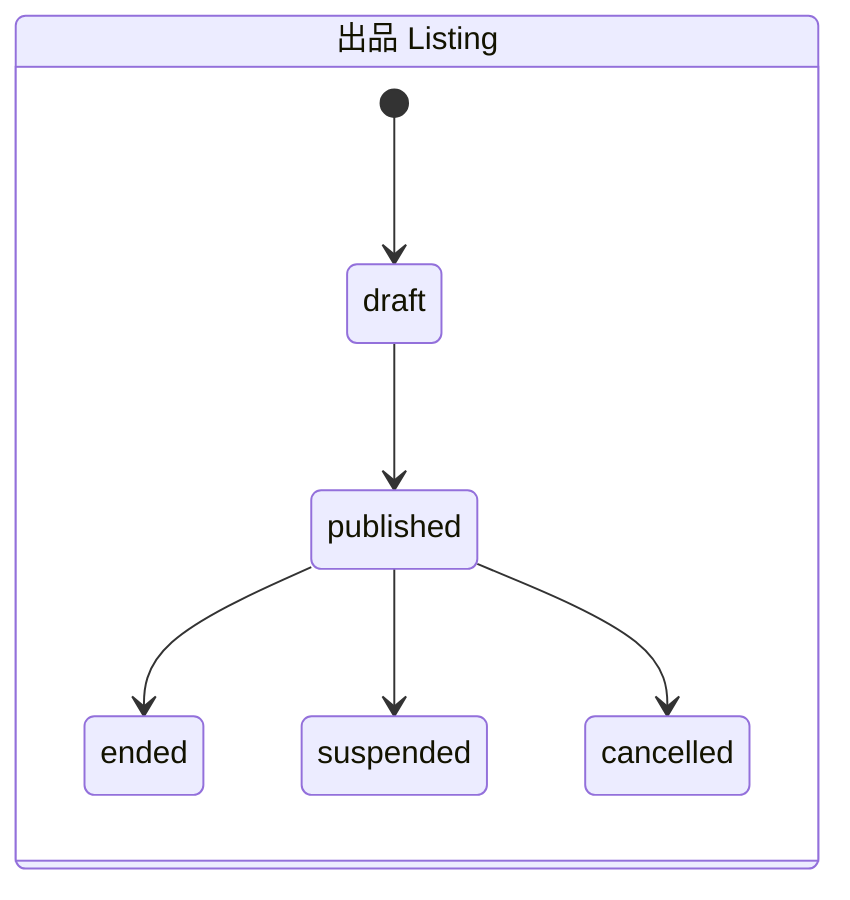

# オークション業務ルール（MVP）

> ルールは [ADR-0007](../architecture/adr/0007-align-with-yahoo-auctions.md)（Yahoo!オークションに合わせる）に従います。Yahoo!オークションとの比較は [`yahoo-auctions-alignment.md`](yahoo-auctions-alignment.md) を参照してください。未決事項は [`open-questions.md`](open-questions.md) を参照してください。現在の画面はブラウザ内だけで動くデモであり、正式な入札APIやDB処理はありません。

## 用語

- 開始価格: 出品者が設定する最初の入札可能価格。
- 最高入札額: 入札者が「ここまでなら払う」と入力した金額。本人以外には表示しない。
- 現在の価格: 自動入札で決まる、その時点の落札予定価格（下の「自動入札」を参照）。入札者がいなければ開始価格。
- 入札単位: 次の入札で現在の価格に上乗せする最低金額。現在の価格の価格帯で決まる。
- 最低入札額: 入札者がいなければ開始価格、いれば「現在の価格＋入札単位」。
- 受付時刻: サーバーが入札を検証・確定した時刻。ブラウザ時計は正式な判定に使わない。

## 状態遷移

- 出品: `draft -> published -> ended`（必要に応じて `suspended` / `cancelled`）
- オークション: `scheduled -> active -> ended`（例外: `cancelled`）
- 取引: `awaiting_payment -> paid -> shipped -> delivered -> completed`
- 例外的な取引状態: `cancelled` / `disputed` / `refunded`（許可条件は未決）

状態変更は許可された遷移だけを受け付け、管理操作や重要な変更は監査対象にします。具体的なキャンセル権限と返金条件は別途決定します。

## 入札成立条件

- 認証済みで、利用停止中ではないユーザーのみ入札できます。
- 自分の出品には入札できません。
- 公開・開催中で、サーバー基準の終了時刻前である必要があります。
- 最高入札額は、最低入札額（入札者がいなければ開始価格、いれば `現在の価格 + 入札単位`）以上です。
- 入札額は正の整数JPYで、サービス上限以下です。
- DBトランザクション内で整合性を再確認し、同時入札はロック等で直列化します。
- 入札APIは冪等性キーを使い、二重送信を防ぎます。
- 入札履歴は原則として削除・上書きしません。

## 終了・落札処理

- 終了判定はサーバー時刻とDB状態で確定します（ワーカーの実行時刻だけに頼りません）。
- 終了処理を再実行しても `Order` が重複しないようにします。
- 入札なし終了と落札あり終了を区別します。
- 終了・落札者確定・`Order` 作成は原子的に行います。
- 通知の失敗で確定状態を巻き戻しません（必要に応じてOutboxパターンを使います）。
- 入札の受付は、DB時刻で受付ロック取得後に判定します。`受付時刻 < 終了時刻` の場合だけ受付け、同時刻または終了時刻以降は拒否します（自動延長で終了時刻が延びた場合は、延長後の終了時刻で判定します）。
- 入札の受付順はオークション行のロック取得後、DBトランザクション内で確定します。

## 入札単位

| 現在の価格 | 入札単位 |
|---:|---:|
| 1円〜1,000円未満 | 10円 |
| 1,000円〜5,000円未満 | 100円 |
| 5,000円〜1万円未満 | 250円 |
| 1万円〜5万円未満 | 500円 |
| 5万円以上 | 1,000円 |

最低入札額以上であれば1円単位で入札でき、入札単位の倍数にそろえる必要はありません。例: 現在の価格が1,000円なら入札単位は100円で、1,100円以上なら1,101円でも入札できます。

公開時に適用するルール版をオークションに固定し、開催中は終了まで同じ版を使います（ADR-0004 の考え方を引き継ぐ）。

## 自動入札

すべての入札を「最高入札額」として扱い、システムがほかの入札者と自動で競ります。

- 入札者が1人のとき、現在の価格は開始価格です。
- 入札者が2人以上のとき、現在の価格は「2番目に高い最高入札額＋その金額に対応する入札単位」です。ただし1番目の最高入札額を超えません。
- 例（入札単位10円）: Aさんの最高入札額が700円のとき、Bさんが500円で入札すると、Aさんが最高額入札者のまま現在の価格は510円。Bさんが715円で入札すると、Bさんが最高額入札者になり現在の価格は710円。
- 同額の最高入札額: 先に受付確定した入札者を最高額入札者とし、現在の価格はその金額とします（公式ヘルプに記載がないため本プロジェクトで決定）。
- 最高額入札者は自分の最高入札額を上げられます（現在の価格は変わりません）。下げる操作は MVP では提供しません。

## 自動延長

- 出品者が出品時に「自動延長：あり／なし」を選びます。既定値は「あり」です。
- 「あり」の場合、終了5分前から終了までに現在の価格が上がると、終了時刻を5分延長します。延長後も同じ条件で何度でも延長します。
- 現在の価格が上がらない入札（最高額入札者が最高入札額を上げた場合など）では延長しません。
- 延長の判定と終了時刻の更新は、入札の受付と同じトランザクション内で行います。

## 即決価格

- 出品者は任意で、開始価格より高い即決価格を設定できます。
- 即決価格以上で入札すると、その時点で即決価格で落札し、オークションを終了します。自動入札は働きません。

## 早期終了

- 出品者は終了日時より前にオークションを終了できます。
- 入札者がいれば、その時点の最高額入札者がその時点の現在の価格で落札します。いなければ落札者なしで終了します。
- 早期終了は取り下げ（キャンセル）とは別の操作です。下の「出品の取り下げ・停止」のルールは変わりません。

## 終了日時

出品者は、出品時刻から13時間後〜7日11時間後の範囲で、1時間単位で終了日時を選びます。

## 出品情報の編集

- `draft`: 出品者は全項目を編集できます。
- 公開後、まだ受付済み入札がない場合: 出品者は商品情報、画像、開始価格、開始・終了時刻、配送条件を編集できます。最低増分は本仕様の価格帯表を適用し、出品ごとの任意設定はできません。サーバーで公開要件・価格・日時を再検証し、変更者と変更時刻を記録します。未開始のオークションは開始時刻を現在時刻以降に設定し、開催中のオークションは開始時刻を変更できません。いずれも終了時刻は編集受付時刻より後でなければなりません。
- 受付済み入札が1件以上ある場合: 出品者は商品説明・状態・画像・価格・終了日時・配送条件を含む出品条件を編集できません。誤記等の修正が必要な場合は運営に申請し、入札者に影響しない修正のみ運営が理由を記録して対応します。
- 運営による停止・審査中は、出品者による編集・公開再開をできません。

## 出品の取り下げ・停止

- `draft`: 出品者は公開せずに破棄できます。監査・法令上必要な記録は別途保持方針に従います。
- 公開後、受付済み入札がない場合: 出品者は取り下げできます。出品は `cancelled` とし、公開一覧・入札受付から除外します。監査記録を残します。
- 受付済み入札が1件以上ある場合: 出品者は取り下げ・キャンセルできず、終了までオークションを継続します。
- 運営者は規約違反、安全上の懸念、法的要請等がある場合、理由を記録していつでも `suspended` にできます。停止中は入札を拒否します。
- 停止を終了時刻前に解除する場合は元の終了時刻を維持します。停止中に終了時刻を過ぎた場合は `cancelled` とし、落札者・注文を作成しません。関係者に可能な範囲で結果を通知します。
- 運営者が入札後の出品をキャンセルする場合も、入札履歴を削除せず、理由・操作者を監査記録に残し、注文を作成しません。

## 取引・決済

落札時に購入者、出品者、落札価格、商品タイトル・説明・配送条件のスナップショットを持つ注文を作成する案です。支払期限、キャンセル、返金、配送事故の手順は事業・決済設計を経て決定します。決済機微情報をアプリDBに保存せず、決済成功は検証済みWebhook等のサーバー情報で確定します。

**この文書は決済を許可するものではありません。** 決済事業者・本人確認・返金・紛争・法務の運用準備が整うまで、本番の資金移動を伴う取引を公開しません。
