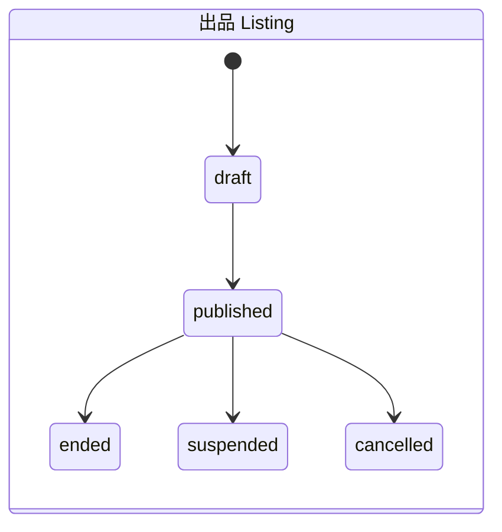

# オークション業務ルール（MVP）

> これは初期ルール案です。未決事項は [`open-questions.md`](open-questions.md) を参照してください。現在の画面はブラウザ内だけで動くデモであり、正式な入札APIやDB処理はありません。

## 用語

- 開始価格: 出品者が設定する最初の入札可能価格。
- 現在価格: 受け付け済み入札の最高額。入札がなければ開始価格を表示上の基準とする。
- 最低入札額: 現在価格に最低入札増分を加えた金額。初回入札では開始価格以上。
- 受付時刻: サーバーが入札を検証・確定した時刻。ブラウザ時計は正式な判定に使わない。

## 状態遷移

- 出品: `draft -> published -> ended`（必要に応じて `suspended` / `cancelled`）
- オークション: `scheduled -> active -> ended`（例外: `cancelled`）
- 取引: `awaiting_payment -> paid -> shipped -> delivered -> completed`
- 例外的な取引状態: `cancelled` / `disputed` / `refunded`（許可条件は未決）

状態変更は許可された遷移だけを受け付け、管理操作や重要な変更は監査対象にします。具体的なキャンセル権限と返金条件は別途決定します。

## 入札成立条件

- 認証済みで、利用停止中ではないユーザーのみ入札できます。
- 自分の出品には入札できません。
- 公開・開催中で、サーバー基準の終了時刻前である必要があります。
- 初回入札額は開始価格以上です。入札がある場合は `現在価格 + 現在価格に対応する最低入札増分` 以上です。
- 入札額は正の整数JPYで、サービス上限以下です。
- DBトランザクション内で整合性を再確認し、同時入札はロック等で直列化します。
- 入札APIは冪等性キーを使い、二重送信を防ぎます。
- 入札履歴は原則として削除・上書きしません。

## 終了・落札処理

- 終了判定はサーバー時刻とDB状態で確定します（ワーカーの実行時刻だけに頼りません）。
- 終了処理を再実行しても `Order` が重複しないようにします。
- 入札なし終了と落札あり終了を区別します。
- 終了・落札者確定・`Order` 作成は原子的に行います。
- 通知の失敗で確定状態を巻き戻しません（必要に応じてOutboxパターンを使います）。
- 終了時刻は延長しません。終了直前も例外扱いにせず、DB時刻で受付ロック取得後に判定します。`受付時刻 < 終了時刻` の場合だけ受付け、同時刻または終了時刻以降は拒否します。
- 入札の受付順はオークション行のロック取得後、DBトランザクション内で確定します。同額の有効入札が競合した場合は先に受付確定した入札を優先します。ただし通常は最低増分の再検証により、先行入札と同額の後続入札は最低額未満として拒否します。

## 最低入札増分

初回の最低入札額は開始価格です（開始価格に増分を加えません）。2件目以降の増分は、直前の最高入札額に適用する価格帯で決めます。

| 基準価格 | 最低入札増分 |
|---:|---:|
| 1〜999円 | 10円 |
| 1,000〜4,999円 | 50円 |
| 5,000〜9,999円 | 100円 |
| 10,000〜49,999円 | 500円 |
| 50,000〜99,999円 | 1,000円 |
| 100,000円以上 | 2,000円 |

最低額以上であれば任意の整数円で入札でき、増分の倍数にそろえる必要はありません。価格帯は新しい入札額ではなく、直前の最高入札額で選びます。例: 現在価格4,950円なら増分50円で最低額5,000円、現在価格5,000円なら増分100円で最低額5,100円です。

この表はMVPルール版1です。オークション公開時に適用ルール版を確定し、開催中のオークションでは終了まで同じ版を使います。

## 出品情報の編集

- `draft`: 出品者は全項目を編集できます。
- 公開後、まだ受付済み入札がない場合: 出品者は商品情報、画像、開始価格、開始・終了時刻、配送条件を編集できます。最低増分は本仕様の価格帯表を適用し、出品ごとの任意設定はできません。サーバーで公開要件・価格・日時を再検証し、変更者と変更時刻を記録します。未開始のオークションは開始時刻を現在時刻以降に設定し、開催中のオークションは開始時刻を変更できません。いずれも終了時刻は編集受付時刻より後でなければなりません。
- 受付済み入札が1件以上ある場合: 出品者は商品説明・状態・画像・価格・終了日時・配送条件を含む出品条件を編集できません。誤記等の修正が必要な場合は運営に申請し、入札者に影響しない修正のみ運営が理由を記録して対応します。
- 運営による停止・審査中は、出品者による編集・公開再開をできません。

## 出品の取り下げ・停止

- `draft`: 出品者は公開せずに破棄できます。監査・法令上必要な記録は別途保持方針に従います。
- 公開後、受付済み入札がない場合: 出品者は取り下げできます。出品は `cancelled` とし、公開一覧・入札受付から除外します。監査記録を残します。
- 受付済み入札が1件以上ある場合: 出品者は取り下げ・キャンセルできず、終了までオークションを継続します。
- 運営者は規約違反、安全上の懸念、法的要請等がある場合、理由を記録していつでも `suspended` にできます。停止中は入札を拒否します。
- 停止を終了時刻前に解除する場合は元の終了時刻を維持します。停止中に終了時刻を過ぎた場合は `cancelled` とし、落札者・注文を作成しません。関係者に可能な範囲で結果を通知します。
- 運営者が入札後の出品をキャンセルする場合も、入札履歴を削除せず、理由・操作者を監査記録に残し、注文を作成しません。

## 取引・決済

落札時に購入者、出品者、落札価格、商品タイトル・説明・配送条件のスナップショットを持つ注文を作成する案です。支払期限、キャンセル、返金、配送事故の手順は事業・決済設計を経て決定します。決済機微情報をアプリDBに保存せず、決済成功は検証済みWebhook等のサーバー情報で確定します。

**この文書は決済を許可するものではありません。** 決済事業者・本人確認・返金・紛争・法務の運用準備が整うまで、本番の資金移動を伴う取引を公開しません。
