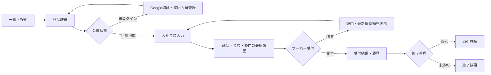

# オークションサイト仕様書

- 文書状態: 要件・業務仕様の基準文書（未決事項は「未決」と記載）
- 対象プロダクト: 日本国内向けC2Cオンラインオークション
- 対象フェーズ: MVP
- 更新日: 2026-10-30
- 関連文書: [`プロトタイプ要件`](prototype-requirements.md)、[`MVPスコープ`](mvp-scope.md)、[`オークション業務ルール`](auction-rules.md)、[`画面一覧`](screens.md)、[`未決事項`](open-questions.md)、[`API設計案`](../api/openapi.md)、[`ドメインモデル`](../architecture/domain-model.md)、[`セキュリティ方針`](../security/security-and-privacy.md)

> この文書は本番MVPの要求仕様です。現在のリポジトリにある静的プロトタイプが実装済みであることを意味しません。実装状況はREADMEとADR-0001「静的フロントエンドプロトタイプ」を参照してください。未決事項を担当者の暗黙判断で確定してはいけません。

## 1. 目的と製品概要

個人が商品を出品し、別の個人が競り上がり形式で入札・落札できる、日本語対応のオークションサービスを提供する。ゲストは出品を閲覧し、会員は購入者と出品者の両方として利用できる。運営者は通報・不正・ユーザー対応を行う。

MVPでは、出品から検索、入札、終了、落札後の模擬取引までを安全に検証する。本番の資金移動を伴う取引は、決済事業者、本人確認、返金、紛争対応、法務と運用の準備が承認されるまで公開しない。

### 1.1 成功指標（初期案）

- 出品開始から公開までの完了率
- 初回入札までの時間、詳細閲覧から入札への転換
- 落札から取引完了までの完了率
- 入札受付の成功率、競合・境界時刻による失敗率
- 不正出品、入札不正、取引トラブルの発生率
- 主要画面の応答時間とサービス可用性

計測方法、目標値、保持期間は未決。個人を過度に追跡しない計測設計を別途定義する。

## 2. 利用者と権限

| 利用者 | 権限・主な操作 |
|---|---|
| ゲスト | 公開出品の一覧・詳細・検索・カテゴリ閲覧 |
| 会員 | ゲスト操作、ウォッチ、入札、自分の出品・プロフィール・通知・取引の閲覧 |
| 出品者 | 出品の作成・編集・公開、自分の出品・落札後取引の管理、発送情報の登録 |
| 購入者 | 入札、落札結果・取引状態の確認、受取確認、評価 |
| 運営者 | 通報審査、出品非公開化、アカウント対応、監査情報の閲覧 |

購入者と出品者は別アカウント種別に分けず、同一会員が両方の機能を利用する。運営権限は一般会員から分離し、最小権限で付与する。

### 2.1 認証前後の境界

- ゲストは公開情報だけを取得できる。
- 入札、ウォッチ、出品、通報、取引操作、アカウント情報の変更は認証を要求する。
- 会員登録・ログインはGoogle認証のみとし、メール/パスワードや他のログインプロバイダーは提供しない。
- Google OIDC認証に成功し、Google IDトークンの `email_verified=true` を確認できた会員を認証済みとする。入札・出品にはさらにアカウント停止中でないことを要求する。
- 初回Google認証は会員登録として扱う。会員識別はGoogle `sub` に紐づけ、メールアドレス一致だけで別のGoogleアカウントを既存会員へ統合しない。
- 認証フロー、サーバー側IDトークン検証、アプリセッション要件は [`ADR-0005`](../architecture/adr/0005-google-only-authentication.md) に定める。認証基盤製品とセッション有効期間は未決。

## 3. MVPスコープ

### 3.1 含める機能

1. Google OIDCによる会員登録、ログイン、ログアウト、アカウント管理
2. 出品の下書き、入力検証、画像、公開、出品管理
3. 商品一覧、商品詳細、検索、カテゴリ・条件絞り込み、並び替え
4. 通常の競り上がりオークション、最低入札額、最高入札者・入札履歴
5. ウォッチリスト
6. 終了確定、落札結果、落札後の取引状態管理
7. サイト内通知と重要イベントのメール通知
8. マイページ、出品履歴、入札履歴
9. 通報、出品の非公開化、最小限の運営画面
10. 運用ログ、監視、バックアップ、品質・セキュリティ検証

### 3.2 MVPで扱わない機能

即決価格、自動入札、終了時自動延長、値下げ交渉、クーポン、ポイント、広告・推薦、複雑な配送事業者連携、独自エスクロー、ネイティブアプリ、多言語・多通貨、ライブオークション、外部サービスからの自動出品は対象外とする。

決済事業者を使った本番の資金移動は、前述の運用準備が整うまで対象外。初期の取引フローはテスト決済または模擬取引に限定する。

## 4. 用語とデータ表現

- 出品 (`Listing`): 商品説明、カテゴリ、状態、画像、配送条件と公開状態を持つ。
- オークション (`Auction`): 開始・終了時刻、開始価格、最低入札増分、状態を持つ。
- 入札 (`Bid`): 会員が特定時点で提示し、サーバーに受け付けられた金額の記録。
- 現在価格: 入札がある場合は受付済み入札の最高額。入札がない場合の画面表示値は開始価格を基準にする。
- 最低入札額: 初回は開始価格以上。以後は現在価格に最低入札増分を加えた額以上。
- 取引 (`Order`): 落札結果から作られる購入者・出品者間の取引記録。

金額は整数の日本円で保存する。浮動小数点を使用しない。日時はDBにUTCで保存し、利用者には原則JSTで表示する。入札成立の正式時刻はサーバー/DB基準とする。

## 5. 機能要件

### 5.1 会員・アカウント

- 登録とログインを分けず、Google認証に成功した初回利用者の会員レコードを作成する。
- Google OIDCを唯一のログイン方法とし、メール/パスワード、パスワード設定・再設定、他社ログインを提供しない。
- OIDC `state`、`nonce`、Authorization Code Flow + PKCEを用い、IDトークンの署名、issuer、audience、期限、nonceをバックエンドで検証する。
- `provider=google` とGoogle `sub` の組み合わせを一意な認証IDとする。メールアドレスは連絡先情報であり、会員ID・自動統合キーとして使用しない。
- `email_verified=true` のGoogleアカウントのみ会員認証を完了できる。別途のメール確認メールは不要。
- 認証後はアプリ独自のサーバーセッションを発行し、Google IDトークンをアプリセッションとして使わない。ログアウトはアプリセッションを失効させる。
- Google認証成功後も、アプリ上の利用停止・退会状態を検査し、権限を付与しない。
- Googleアカウント認証はKYCや法的本人確認ではない。
- Googleアカウント復旧、プロフィールと連絡先メールの公開・編集、セッションの有効期間、アカウント削除後の入札・取引記録の扱いは未決。

### 5.2 出品

出品入力は少なくとも次の情報を扱う。

| 項目 | 要件 |
|---|---|
| タイトル | 必須。長さ上限は未決。HTML等の危険な入力を無害化する |
| 説明 | 必須。長さ上限、許可書式は未決。表示時のXSSを防ぐ |
| カテゴリ | 必須。運営管理のカテゴリから選択する。体系は未決 |
| 商品状態 | 必須。MVPの状態候補と表示説明を定める |
| 画像 | MVP要件。形式・サイズ・枚数・変換・削除条件は未決。実体検査を行う |
| 開始価格 | 必須。正の整数JPY、上限以下 |
| 開始・終了日時 | 必須。サーバーで妥当性を検証。最短・最長期間は未決 |
| 配送条件 | 必須。送料負担、配送説明等を出品時点で確認可能にする |

- 下書き保存とプレビューを提供する。
- 公開前に必須情報・画像・禁止商品規則をサーバー側で検証する。
- 公開後の編集・取り下げは、受付済み入札の有無に応じた [`ADR-0004`](../architecture/adr/0004-auction-operating-rules.md) の条件に従う。
- 出品者は自分の出品に入札できない。
- 出品者は受付済み入札後に取り下げられない。運営停止・キャンセルは理由を監査記録し、入札履歴を保持して注文を作らない。

### 5.3 商品発見・閲覧

- 公開・開催中の出品を一覧・詳細で閲覧できる。
- キーワード、カテゴリ、状態、価格帯、終了状態等のフィルター候補を提供する。初期フィルターの採用範囲は未決。
- 並び替えは新着、終了が近い、価格、入札数を候補とする。
- 詳細にはタイトル、説明、画像、状態、開始価格、現在価格、最低入札額、終了日時（JST）、残り時間、入札数、配送条件、出品者プロフィール要約、入札履歴を表示する。
- カウントダウンは案内表示であり、終了判定はサーバーに従う。
- 入札履歴に他ユーザーの個人情報を表示しない。公開範囲と匿名化方式は未決。

### 5.4 入札

入札リクエストごとにサーバーが以下を確認する。

1. Google OIDC認証済み（検証済みIDトークンの `email_verified=true`）で、利用停止中でない会員である。
2. 対象が存在し、公開中かつ開催中である。
3. 入札者が出品者本人でない。
4. DB受付時刻が終了時刻より前（厳密に `< ends_at`）である。終了時刻ちょうどとその後は拒否する。
5. 金額が正の整数JPYで、設定上限以下である。
6. 初回は開始価格以上、以後は受付済み最高額に [`auction-rules.md`](auction-rules.md) の価格帯増分を加えた額以上である。
7. トランザクション中に最新状態を確認し、並行入札を直列化する。
8. 冪等性キーを検証し、再送で履歴・価格を二重登録しない。

- 入札の最終確認では商品、提示金額、現在価格、確定後の拘束・取消条件を明示する。
- 受付成功後は受付結果、確定金額、受付時刻を返す。拒否時は理由と再入力可能な最低額等を返す。
- 受付済み履歴は追記型とし、通常削除・上書きしない。
- 最低入札増分、同額入札の受付順、終了直前の扱いは [`ADR-0004`](../architecture/adr/0004-auction-operating-rules.md) に定める。入札取消の可否と金額上限は引き続き未決。

### 5.5 終了・落札

- オークション終了は予定ジョブの実行時刻だけに依存しない。API・終了処理がサーバー時刻とDB状態を確認する。
- 終了更新、最高入札者確定、注文作成は競合を考慮して原子的に行う。
- 終了処理は再実行可能で、同一オークションから注文を重複作成しない。
- 入札なし終了と落札あり終了を区別する。
- 終了後は新規入札を拒否し、終了時刻は延長しない。
- 通知失敗で入札・落札状態を巻き戻さない。必要に応じてOutbox等で送信を再試行する。
- 終了直前の受付境界は [`ADR-0004`](../architecture/adr/0004-auction-operating-rules.md) に定める。自動入札はMVP対象外。

### 5.6 ウォッチリスト

- 認証会員は公開出品を追加・解除できる。
- 同一会員・同一出品の重複登録を防ぐ。
- 出品終了・非公開化時の表示、通知の有無は未決。
- 他会員のウォッチリストを閲覧できない。

### 5.7 取引・配送・評価

- 落札後に注文を作り、購入者、出品者、確定価格、出品時の商品・配送条件スナップショットを保持する。
- 状態案は `awaiting_payment -> paid -> shipped -> delivered -> completed`。例外状態 `cancelled` / `disputed` / `refunded` は別途許可条件を決める。
- 模擬取引では資金移動を発生させない。テスト決済を追加する場合も外部テスト環境に限定し、本番決済と分離する。
- 発送方法、追跡番号、発送・受取確認、評価機能はMVPに含めるが、必須項目、期限、評価公開、未対応時の自動遷移は未決。
- カード番号等の決済機微情報をアプリDBに保存しない。
- 支払い期限、未払い時の制限、キャンセル・返品・返金・紛争対応は事業・決済ADRが承認するまで確定しない。

### 5.8 通知

- サイト内通知を提供し、既読状態を管理する。
- 入札の結果、落札、出品終了、取引状態変更等を通知候補とする。
- 重要イベントのメール通知を提供する。具体的な対象・配信停止設定・再送間隔は未決。
- 通知送信はドメイン状態更新と分離し、重複排除・再送・失敗監視を行う。

### 5.9 通報・運営機能

- 会員は出品等を理由付きで通報できる。通報カテゴリ・自由記述・添付の設計は未決。
- 運営者は通報一覧、対象詳細、審査状態、対応履歴を確認できる。
- 運営者は権限に応じて出品を非公開化し、アカウント状態を変更できる。
- 管理操作は実行者、対象、操作、理由、時刻を監査ログに記録する。
- 審査基準、停止期間、異議申立て、管理者の多段承認要否は未決。

## 6. 画面と主要フロー

### 6.1 主要画面

- ホーム・カテゴリ一覧
- 検索結果・絞り込み・並び替え
- 商品詳細・入札履歴
- Googleでログイン・初回会員登録、ログアウト、アカウント管理
- 出品フォーム・プレビュー・出品管理
- 入札確認・入札結果
- ウォッチリスト・マイページ
- 出品履歴・入札履歴
- 落札後の取引詳細・通知一覧
- 通報一覧・出品審査・ユーザー管理（運営者）

### 6.2 購入者フロー

### 6.3 出品者フロー

`Googleログイン -> 出品情報入力 -> プレビュー -> サーバー検証 -> 公開 -> 出品管理 -> オークション終了 -> 落札時は取引詳細・発送管理`

### 6.4 運営者フロー

`運営者認証 -> 通報一覧 -> 対象と履歴の確認 -> 審査判断 -> 非公開化/アカウント対応 -> 理由付き監査記録 -> 関係者通知`

画面ごとの空状態、ローディング、権限不足、入力エラー、通信失敗、再試行は [`screens.md`](screens.md) と画面設計で具体化する。

## 7. データ要件

主要エンティティは `User`, `AuthIdentity`, `Listing`, `ListingImage`, `Category`, `Auction`, `Bid`, `WatchlistItem`, `Order`, `Payment`, `Shipment`, `Notification`, `Report`, `AuditLog` とする。詳細属性・関連は [`domain-model.md`](../architecture/domain-model.md) を参照する。

- `Bid` は受け付けられた金額、入札者、対象オークション、サーバー受付時刻、冪等性情報を追跡できる。
- `Order` は後日の出品編集に影響されないスナップショットを保持する。
- 一意制約等で同じオークションの落札注文重複、ウォッチ重複、冪等性キー重複処理を防ぐ。
- 退会後の入札・注文・監査記録の匿名化・保持期間は未決であり、個人情報方針と合わせて決定する。

## 8. API要件

APIは認証・認可、サーバー側入力検証、共通エラー形式、ページネーション、レート制限を備える。入札は冪等性キー必須とし、最新価格・状態をトランザクション内で再確認する。金額は整数JPY、API日時はUTC RFC 3339とする。

リソース候補、入札リクエスト/レスポンス、エラーコードは [`api/openapi.md`](../api/openapi.md) を参照する。同文書は将来案であり、採用技術・認証基盤実装・セッション方式確定後にOpenAPI定義として契約化する。

## 9. 非機能要件

### 9.1 セキュリティとプライバシー

- すべての更新APIで認証、認可、所有者確認を行う。
- SQLインジェクション、XSS、CSRF、SSRF、IDOR、認証情報漏えいを防ぐ。
- ログイン、出品、入札、通報にレート制限を設ける。
- 画像の形式・サイズ・個数を検証し、拡張子のみを信用しない。EXIF位置情報除去を検討する。
- 秘密情報はSecrets Manager等で管理し、Gitやログへ出さない。
- ログは必要最小限の個人情報だけを扱い、決済情報・認証トークンを記録しない。
- 保存期間、削除請求、アクセス権、バックアップ復元を運用設計に含める。
- 詳細は [`security-and-privacy.md`](../security/security-and-privacy.md) に従う。

### 9.2 アクセシビリティ・UX

- モバイルファーストとし、主要画面はWCAG 2.2 AAを目標にする。
- キーボード操作、フォーカス可視化、フォームラベル、エラー説明、色に依存しない状態表示を提供する。
- 価格、送料、締切、入札確定後の影響を明瞭に表示する。
- 読み込み、空、エラー、権限不足、通信再試行の状態を設計する。

### 9.3 可用性・性能・監視

数値目標（可用性、p95応答、同時入札、RPO/RTO）は未決。公開前に運用責任者が設定する。最低限、APIエラー率、入札受付・拒否理由、終了処理滞留、通知失敗、バックアップ状態を監視し、個人情報を含まない相関IDで追跡する。

## 10. 受け入れ条件・品質ゲート

- 登録から出品、検索、入札、終了、落札後取引までをテスト環境で一貫して確認できる。
- 正常系、無効入力、権限不足、停止会員、本人入札、終了境界、金額境界を検証する。
- 同時入札を含む統合テストで受付順序、現在価格、履歴、冪等性を検証する。
- 終了ジョブの再実行・入札との競合・重複注文防止を検証する。
- 未認可アクセス、IDOR、レート制限、画像入力、Webhook署名をセキュリティ検証する。
- DB migration、既存データ影響、ロールバック/復旧手順をレビューする。
- Lint、型チェック、自動テストが通過し、画面/API/DB変更に合わせ文書を更新する。
- バックアップからの復元、ジョブ再実行、通知失敗からの復旧を運用検証する。

## 11. 未決事項と決定手順

次の項目は未決であり、本仕様書だけでは決定しない。

- マネタイズ、手数料、税
- 決済事業者、入出金、返金、紛争、テスト決済範囲
- KYC条件、年齢制限、出品制限
- 禁止商品、通報基準、停止・異議申立て
- 自動入札と終了時自動延長はMVP対象外
- キャンセル、返品、未払い、配送事故、支払期限
- カテゴリ、状態ラベル、画像数・サイズ、検索フィルター
- クラウド、DB、Google OIDC認証基盤製品、メール通知、監視、バックアップ事業者
- 運用責任者、SLO、RPO/RTO、保持期間

決定前に担当者と期限を設定し、必要な法務・決済・運用確認を行う。技術選定と事業ルールの決定は別々のADRに記録し、この仕様書・API・画面・テストを同じ変更で更新する。最低入札増分、同額入札の順序、固定終了時刻の境界、出品編集・取り下げ条件は [`ADR-0004`](../architecture/adr/0004-auction-operating-rules.md) で決定済み。

## 12. 現行プロトタイプとの差分

現状は静的HTML/CSS/JavaScriptで、サンプル出品、検索、カテゴリ、並び替え、詳細、ブラウザ内ウォッチ、デモ入札、ローカル出品を提供する。実認証・メール、共有DB/API、サーバー入札と終了処理、落札注文、通知、画像アップロード、取引、通報・管理、監視・バックアップは未実装である。`localStorage` の状態は改変可能で、取引記録として信頼できない。

したがって、この仕様書の本番MVP要件を満たすまで、本番出品・入札・決済を受け付けない。
